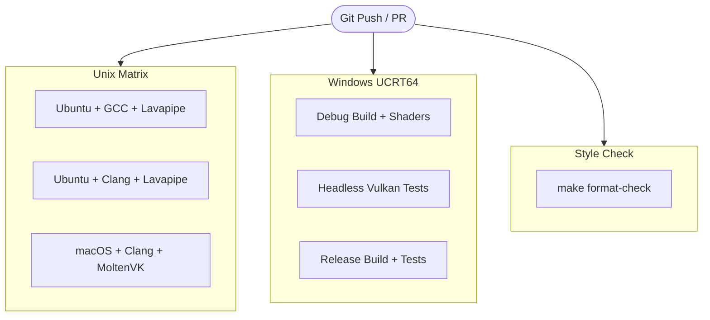

# `.github/workflows/` — Continuous Integration (CI) Automation

This directory contains GitHub Actions workflows that automatically build, test, compile shaders, analyze, and format-check the Vulkan project across all major operating systems on every commit and pull request.

---

## Workflow Overview: `ci.yml`

The CI workflow is defined in [`ci.yml`](ci.yml) and triggers on:
- Every `push` to any branch
- Every `pull_request` targeting any branch
- Manual execution via `workflow_dispatch`

It consists of three parallel jobs:



---

## Job Details

### 1. `unix` (Ubuntu & macOS Matrix)
Runs on `ubuntu-latest` and `macos-latest` across compilers:
- **Dependencies Installed**:
  - **Linux**: `libvulkan-dev`, `libglfw3-dev`, `glslc` (`shaderc`), `mesa-vulkan-drivers` (providing the software Lavapipe Vulkan ICD), and `xvfb` for headless window creation.
  - **macOS**: `vulkan-headers`, `molten-vk`, `glfw`, `shaderc`.
- **Execution Steps**:
  1. **Debug Build**: `make CC=<cc> WERROR=1` compiles all C sources and compiles shaders to SPIR-V.
  2. **Vulkan Unit Tests (Debug)**: Executed under `xvfb-run` to test Vulkan instance creation, physical device enumeration (Lavapipe CPU rasterizer), and SPIR-V headers.
  3. **Sanitizers (Linux)**:
     ```bash
     xvfb-run --auto-servernum make test CC=<cc> WERROR=1 SANITIZE=address,undefined BUILD_DIR=build-asan
     ```
     Runs tests under AddressSanitizer (ASan) and UndefinedBehaviorSanitizer (UBSan) in an isolated directory (`build-asan/`).
  4. **Release Build**: `make release CC=<cc> WERROR=1` verifies optimized `-O2` builds.

---

### 2. `windows` (MSYS2 UCRT64)
Runs on `windows-latest` using the modern MSYS2 UCRT64 runtime:
- Sets up MSYS2 via `msys2/setup-msys2@v2` with:
  `mingw-w64-ucrt-x86_64-gcc`, `mingw-w64-ucrt-x86_64-make`, `mingw-w64-ucrt-x86_64-vulkan-loader`, `mingw-w64-ucrt-x86_64-vulkan-headers`, `mingw-w64-ucrt-x86_64-shaderc`, `mingw-w64-ucrt-x86_64-glfw`.
- Executes commands directly inside the MSYS2 bash environment:
  1. `mingw32-make WERROR=1` (builds binary and compiles SPIR-V shaders)
  2. `mingw32-make test WERROR=1` (executes test suite)
  3. `mingw32-make release test WERROR=1` (verifies release build)

---

### 3. `format` (Clang-Format Style Enforcement)
Runs on `ubuntu-latest`:
- Executes `make format-check`.
- Invokes `clang-format --dry-run --Werror` on all `.c` and `.h` files in `src/`, `include/`, and `tests/`.
- Fails the build if any committed file does not conform to the root `.clang-format` rules.

---

## How to Reproduce CI Steps Locally

Before pushing changes to GitHub, you can run the exact same checks locally:

```bash
# 1. Compile project and shaders with warnings as errors
make WERROR=1

# 2. Run Vulkan unit tests
make test WERROR=1

# 3. Test release build
make release test WERROR=1

# 4. Run Address & Undefined Sanitizers (Linux/macOS)
make test SANITIZE=address,undefined

# 5. Check formatting compliance
make format-check

# 6. Apply formatting fixes automatically if format-check failed
make format
```
