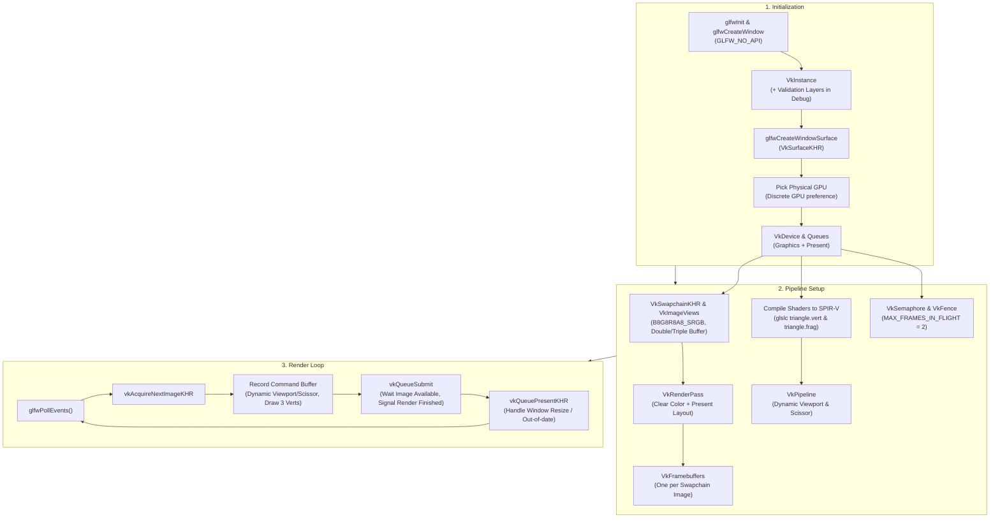

# Vulkan C++23 Project Template (Triangle)

A professional, cross-platform, zero-friction Vulkan C++ project template rendering a modern Vulkan Triangle with automatic GLSL-to-SPIR-V shader compilation, Pragmatic C++23 RAII lifecycle management, validation layers, dynamic state handling, and turnkey tooling.

Compiles out of the box on **Windows** (MSYS2 UCRT64, native `cmd.exe`, PowerShell, Git Bash, or LunarG Vulkan SDK), **Linux**, and **macOS** (MoltenVK) using **GNU Make**, **GCC (g++)** or **Clang (clang++)**, **glslc**, **clangd**, **GDB/LLDB**, and **VS Code**.

---

## Table of Contents

1. [Key Features](#key-features)
2. [Project Structure](#project-structure)
3. [Prerequisites & Toolchain Setup](#prerequisites--toolchain-setup)
4. [Quick Start](#quick-start)
5. [Configuration Guide (`config.mk`)](#configuration-guide-configmk)
6. [Pragmatic C++23 Architecture](#pragmatic-c23-architecture)
7. [Vulkan Architecture & Rendering Pipeline](#vulkan-architecture--rendering-pipeline)
8. [Automatic Shader Pipeline (`shaders/`)](#automatic-shader-pipeline-shaders)
9. [Drop-In Dependency Architecture](#drop-in-dependency-architecture)
10. [Unit & Headless Testing System](#unit--headless-testing-system)
11. [Code Quality & Tooling](#code-quality--tooling)
12. [Visual Studio Code Integration](#visual-studio-code-integration)
13. [Continuous Integration (GitHub Actions)](#continuous-integration-github-actions)
14. [Make Targets Reference](#make-targets-reference)
15. [Troubleshooting & FAQ](#troubleshooting--faq)
16. [License](#license)

---

## Key Features

- **Pragmatic C++23 Design**:
  Clean, deterministic RAII without heavy OOP bloat or complex template metaprogramming. Uses standard library containers (`std::vector`, `std::array`, `std::span`), zero-allocation string views (`std::string_view`), optional states (`std::optional`), and type-safe formatted I/O (`std::format`).
- **Complete Vulkan Triangle Engine**:
  GLFW windowing with `GLFW_NO_API`, Vulkan surface, physical GPU rating (discrete GPU preference), logical device and queue retrieval, swapchain management, render pass configuration, dynamic viewport and scissor states, bufferless vertex rendering, double-buffering synchronization with semaphores and fences (`MAX_FRAMES_IN_FLIGHT = 2`), and robust swapchain recreation on window resize and minimization.
- **Automatic Shader Pipeline (`shaders/`)**:
  Any GLSL shader placed in `shaders/` (`.vert`, `.frag`, `.comp`, etc.) is automatically discovered, incrementally compiled to SPIR-V (`.spv`) via Google's `glslc`, and deployed into `build/<mode>/bin/shaders/` alongside your executable.
- **Built-in Vulkan Validation Layers**:
  Debug builds (`BUILD=debug`) automatically enable `VK_LAYER_KHRONOS_validation` and attach a formatted debug messenger callback. Release builds (`BUILD=release`) compile with `-O2 -DNDEBUG -s` and strip validation layers for zero overhead.
- **Single Configuration Point (`config.mk`)**:
  All project settings live in `config.mk`. Automatically detects LunarG Vulkan SDK environment variables (`VULKAN_SDK`), uses `pkg-config` (`vulkan glfw3`), and provides reliable platform-specific fallback flags.
- **Zero-Friction Drop-In Architecture (`include/`, `lib/`, `bin/`)**:
  Drop headers into `include/`, static/import libraries into `lib/`, and runtime shared libraries (`.dll`, `.so`, `.dylib`) into `bin/`. The build system automatically indexes, links, and deploys them.
- **Dual Build Modes**:
  Clean separation of debug (`build/debug/`) and release (`build/release/`) artifacts.
- **Headless Vulkan Testing (`make test`)**:
  Built-in test suite (`tests/test_vulkan.cpp`) verifies GLFW Vulkan capability, `VkInstance` creation and destruction, GPU enumeration, and SPIR-V bytecode headers without requiring an interactive window.
- **Dynamic `compile_commands.json` Generation**:
  Accurate compilation database generated directly from Makefile flags on every build, providing **clangd** and **clang-tidy** perfect code intelligence with zero configuration drift.
- **Turnkey VS Code Integration**:
  Pre-configured tasks (`tasks.json`), F5 debugging with GDB/LLDB pretty-printing (`launch.json`), clangd language server (`settings.json`), and recommended GLSL extensions.
- **Cross-Platform CI Matrix**:
  Multi-platform GitHub Actions workflow covering Linux (GCC & Clang with software Lavapipe rasterization), macOS (Clang & MoltenVK), Windows (MSYS2 UCRT64), Sanitizers, and formatting checks.

---

## Project Structure

Each directory contains a dedicated `README.md` detailing its conventions, discovery rules, and best practices:

```text
.
├── config.mk                 # Project identity, C++23 flags, and configuration (user-editable)
├── Makefile                  # Portable C++ build engine (POSIX sh & Windows cmd.exe — do not edit)
├── compile_commands.json     # Clang compilation database (auto-generated by make)
├── .clang-format             # Code formatting rules (LLVM-based, tabs, clean style)
├── .clang-tidy               # Static analysis rules tailored for modern C++23
├── .gitattributes            # Line endings and binary file handling
├── .gitignore                # Ignores build outputs, caches, and system files
├── LICENSE                   # MIT License
│
├── src/                      # [README] Application C++ source code
│   ├── main.cpp              # Entry point: argument parsing and lifecycle coordination
│   ├── vulkan_app.cpp        # VulkanApp class implementation (Pragmatic C++23 RAII)
│   └── README.md             # Guide: source organization and engine lifecycle
│
├── include/                  # [README] Public interface headers
│   ├── vulkan_app.hpp        # VulkanApp class declaration and state
│   └── README.md             # Guide: header inclusion, API contracts, C++ library drop-ins
│
├── shaders/                  # [README] GLSL shader source files
│   ├── triangle.vert         # Vertex shader: bufferless triangle positions and RGB colors
│   ├── triangle.frag         # Fragment shader: color interpolation output
│   └── README.md             # Guide: shader stages, glslc compilation, SPIR-V bytecode
│
├── lib/                      # [README] Drop-in static & import libraries (.a, .lib, .dll.a, .so, .dylib)
│   └── README.md             # Guide: auto-linking, smart selection, order-independent linking
│
├── bin/                      # [README] Drop-in runtime dynamic libraries (.dll, .so, .dylib)
│   └── README.md             # Guide: automatic deployment to build/bin, rpath handling
│
├── tests/                    # [README] Standalone unit test suites
│   ├── test_framework.hpp    # Minimal, dependency-free C++23 test assertion macros
│   ├── test_vulkan.cpp       # Headless Vulkan capability & shader verification test
│   └── README.md             # Guide: writing tests, running suites, custom frameworks
│
├── build/                    # Generated automatically during compilation (ignored by git)
│   ├── debug/                # Debug artifacts (-g3 -O0 -DDEBUG, validation layers)
│   │   ├── bin/              # Executables, test runners, shaders/, and copied runtime DLLs
│   │   └── obj/              # Object (.o) and dependency (.d) files
│   └── release/              # Release artifacts (-O2 -DNDEBUG -s, optimized)
│       ├── bin/
│       └── obj/
│
├── .vscode/                  # [README] Turnkey Visual Studio Code configuration
│   ├── extensions.json       # Recommended extensions (clangd, cpptools, makefile-tools, shader)
│   ├── launch.json           # F5 debug launcher (GDB/LLDB, integrated & external console)
│   ├── settings.json         # clangd language server, format-on-save, search exclusions
│   ├── tasks.json            # Build, test, shaders, clean, format, tidy, and configure tasks
│   └── README.md             # Guide: VS Code tasks, debugging profiles, MSYS2 PATH injection
│
└── .github/                  # GitHub Actions configuration
    └── workflows/            # [README] Multi-OS matrix CI
        ├── ci.yml            # Workflow definition (Linux, macOS, Windows UCRT64, ASan/UBSan)
        └── README.md         # Guide: CI matrix, reproducible local checks, pull request gate
```

---

## Prerequisites & Toolchain Setup

### Windows (MSYS2 UCRT64 — Recommended)

1. Download and install [MSYS2](https://www.msys2.org/).
2. Open the **MSYS2 UCRT64** terminal and install the required tools:
   ```bash
   pacman -S --needed \
       mingw-w64-ucrt-x86_64-gcc \
       mingw-w64-ucrt-x86_64-gdb \
       mingw-w64-ucrt-x86_64-make \
       mingw-w64-ucrt-x86_64-vulkan-loader \
       mingw-w64-ucrt-x86_64-vulkan-headers \
       mingw-w64-ucrt-x86_64-shaderc \
       mingw-w64-ucrt-x86_64-glfw \
       mingw-w64-ucrt-x86_64-clang-tools-extra
   ```
3. Add `C:\msys64\ucrt64\bin` and `C:\msys64\usr\bin` to your Windows `PATH` environment variable.
4. On Windows command prompts, you can invoke `mingw32-make` directly (or alias `make` to `mingw32-make`).

> [!NOTE]
> **LunarG Vulkan SDK Support**: If you installed the official [LunarG Vulkan SDK](https://vulkan.lunarg.com/), the build system automatically detects the `VULKAN_SDK` environment variable and includes its headers and library paths.

### Linux (Debian / Ubuntu)

```bash
sudo apt update
sudo apt install build-essential g++ gdb clangd clang-format clang-tidy \
                 libvulkan-dev vulkan-tools libglfw3-dev glslc mesa-vulkan-drivers
```

### Linux (Arch / Manjaro)

```bash
sudo pacman -S base-devel gcc gdb clang vulkan-devel glfw shaderc
```

### macOS (Homebrew / MoltenVK)

```bash
brew install make llvm vulkan-headers molten-vk glfw shaderc
```

---

## Quick Start

Open a terminal in the project directory:

```bash
# 1. Build in debug mode (compiles C++23 sources and GLSL shaders)
make

# 2. Run the Vulkan Triangle application
make run

# 3. Compile shaders independently
make shaders

# 4. Run the headless Vulkan unit tests
make test

# 5. Build in release mode (optimized -O2, stripped symbols, validation layers off)
make release

# 6. Build and run in release mode
make release run

# 7. Check build configuration, detected libraries, and paths
make info

# 8. Clean all build outputs
make clean
```

> **Windows Note**: If `make` is not aliased, run `mingw32-make` instead. All targets, variables, and flags work identically.

---

## Configuration Guide (`config.mk`)

All project settings are centralized in [`config.mk`](config.mk). The generic [`Makefile`](Makefile) reads these variables and applies them across all recipes. Every variable uses `?=` so it can be overridden from the command line (e.g., `make CXX=clang++ BUILD=release`).

### Configuration Variables Reference

| Variable | Default Value | Description |
|---|---|---|
| `PROJECT` | Current folder name | Output binary name. Spaces are automatically converted to underscores. |
| `VERSION` | `0.1.0` | Injected into preprocessor as `PROJECT_VERSION=\"...\"`. |
| `PROJECT_TYPE` | `executable` | Target type: `executable` for Vulkan applications. |
| `BUILD` | `debug` | Default build mode: `debug` (validation layers on) or `release` (validation layers off). |
| `CXX` | `g++` | C++ compiler (`g++`, `clang++`, or cross-compilation triple). |
| `CXX_STANDARD` | `c++23` | C++ language standard: `c++23`, `c++20`, `c++17`. |
| `WARNINGS` | `-Wall -Wextra ...` | Strict compilation warning flags. |
| `WERROR` | `0` | When set to `1`, treats all warnings as fatal errors (recommended for CI). |
| `DEBUG_CXXFLAGS` | `-g3 -O0 -DDEBUG` | Applied in debug mode (activates validation layers). |
| `RELEASE_CXXFLAGS` | `-O2 -DNDEBUG` | Applied in release mode (optimizations enabled). |
| `GLSLC` | `glslc` | Path to the Google `glslc` shader compiler. |
| `SHADER_DIR` | `shaders` | Directory containing GLSL shader source files. |
| `PKG_CONFIG_PACKAGES` | `vulkan glfw3` | Packages queried via `pkg-config`. |
| `LDLIBS` | Platform-specific | Fallback system libraries (`-lvulkan-1 -lglfw3 -lgdi32` on Windows). |
| `SRC_DIR` | `src` | Directory containing application source code. |
| `INC_DIR` | `include` | Directory containing public header files. |
| `LIB_DIR` | `lib` | Directory containing drop-in static and import libraries. |
| `BIN_DIR` | `bin` | Directory containing drop-in runtime shared libraries. |
| `TEST_DIR` | `tests` | Directory containing unit test suites (`test_*.cpp`). |
| `BUILD_DIR` | `build` | Output directory for all compiled object and binary files. |

---

## Pragmatic C++23 Architecture

This template strikes a pragmatic balance for graphics programming:

1. **RAII Resource Management**:
   The `VulkanApp` class owns all Vulkan and GLFW handles. Its destructor deterministically waits for GPU idle and destroys all resources in reverse creation order.
2. **Standard Containers**:
   `std::vector` manages dynamic swapchain images, image views, and framebuffers without raw `malloc`/`free`.
3. **`std::span` Interface**:
   Array slices and buffer views are passed cleanly without pointer/length decoupling.
4. **Fast, Standard Vulkan C Headers**:
   Uses standard `<vulkan/vulkan.h>` instead of heavy C++ template bindings (`vulkan.hpp`), keeping build times fast while enjoying all C++ language conveniences.

---

## Vulkan Architecture & Rendering Pipeline

The template implements the standard modern Vulkan rendering pipeline:



---

## Automatic Shader Pipeline (`shaders/`)

Vulkan executes SPIR-V intermediate bytecode rather than raw GLSL source text. The template provides fully automated shader discovery and compilation:

1. **Drop-in GLSL**: Place `.vert`, `.frag`, or `.comp` files directly into `shaders/`.
2. **Incremental Compilation**: The Makefile compiles only modified shaders into `build/<mode>/bin/shaders/<name>.<stage>.spv` using `glslc`.
3. **Runtime Loading**: Shaders are co-located next to the produced binary and can also be loaded relative to the project root.
4. **Bufferless Vertex Generation**: The vertex shader generates triangle vertices directly from `gl_VertexIndex`, avoiding unnecessary vertex buffer setup for Hello Triangle.

---

## Drop-In Dependency Architecture

Adding third-party libraries and code requires **zero Makefile modifications**:

- **Headers (`include/` and `src/`)**: Every subdirectory is automatically added to the include path (`-I`).
- **Static & Import Libraries (`lib/`)**: Discovers `.a`, `.lib`, `.dll.a`, `.so`, and `.dylib`. Auto-links with order-independent groups (`-Wl,--start-group ... -Wl,--end-group`).
- **Runtime Shared Libraries (`bin/`)**: Any `.dll`, `.so`, or `.dylib` in `bin/` or `lib/` is automatically copied into `build/<mode>/bin/` alongside your executable.

---

## Unit & Headless Testing System

The template features a standalone, modular testing system in `tests/`:

```bash
make test
```

### Architecture
- **Suite Isolation**: Every file named `tests/test_*.cpp` is compiled into an isolated executable in `build/<mode>/bin/test_<name>[.exe]`.
- **Application Logic Included**: Test suites are automatically linked against all project source objects in `src/` (excluding `src/main.cpp`), granting direct access to internal engine modules.
- **Vulkan Verification (`test_vulkan.cpp`)**: Validates GLFW Vulkan support, `VkInstance` creation and destruction, GPU enumeration, and SPIR-V bytecode magic numbers (`0x07230203`).

---

## Code Quality & Tooling

### Clang-Format (`make format` / `make format-check`)

Format all project sources and headers according to [`.clang-format`](.clang-format):
```bash
make format
```

Check code formatting without modifying files (used in CI):
```bash
make format-check
```

### Clang-Tidy (`make tidy`)

Run in-depth static analysis across all project sources using [`.clang-tidy`](.clang-tidy):
```bash
make tidy
```

### Automatic `compile_commands.json`

Every time `make` is invoked, it writes an exact compilation database (`compile_commands.json`) containing the exact compiler flags, macros, and include paths for every source file.
- **clangd** uses this file for instantaneous, precise code intelligence, jump-to-definition, and refactoring.
- **clang-tidy** uses this file to resolve includes and language dialects during analysis.

---

## Visual Studio Code Integration

Open the workspace folder in VS Code (`code .`):

- **IntelliSense**: Powered by the recommended **clangd** extension via `compile_commands.json`.
- **Keyboard Shortcuts**:
  - `Ctrl + Shift + B`: Run default build task (compiles project and shaders).
  - `F5`: Build and launch with GDB / LLDB debugger.
  - `Ctrl + F5`: Run without debugging.
- **Tasks (`Terminal > Run Task...`)**:
  - `Build`, `Build Release`, `Compile Shaders`, `Run`, `Test`, `Clean`, `Rebuild`, `Format`, `Tidy`, `Configure`.

See [`.vscode/README.md`](.vscode/README.md) for complete details.

---

## Continuous Integration (GitHub Actions)

The repository includes a multi-platform CI workflow in [`.github/workflows/ci.yml`](.github/workflows/ci.yml):

- **Ubuntu (GCC & Clang)**: Debug build, shader compilation, headless test run via `xvfb-run` and Mesa Lavapipe software rasterization, AddressSanitizer + UndefinedBehaviorSanitizer run, Release build.
- **macOS (Clang)**: Debug build, shader compilation, MoltenVK linkage, Release build.
- **Windows (MSYS2 UCRT64)**: Debug build, shader compilation, headless test run, Release build.
- **Clang-Format Gate**: Verifies style compliance across all files.

See [`.github/workflows/README.md`](.github/workflows/README.md) for local verification steps.

---

## Make Targets Reference

| Target | Description | Example Command |
|---|---|---|
| `all` *(default)* | Build application and compile all shaders in debug mode | `make` |
| `release` | Build optimized release binary without validation layers | `make release` |
| `shaders` | Compile GLSL shaders in `shaders/` to SPIR-V | `make shaders` |
| `run` | Build and execute the Vulkan Triangle application | `make run ARGS="--help"` |
| `test` | Build and run all test suites in `tests/` | `make test` |
| `clean` | Delete the `build/` directory | `make clean` |
| `rebuild` | Clean and rebuild everything | `make rebuild` |
| `format` | Format all source and header files | `make format` |
| `format-check` | Check formatting compliance without editing | `make format-check` |
| `tidy` | Run `clang-tidy` static analysis | `make tidy` |
| `info` | Display detected toolchains, flags, shaders, and libraries | `make info` |
| `help` | Print Makefile usage and variable summary | `make help` |
| `run-<test_name>` | Build and execute a single test suite | `make run-test_vulkan` |

---

## Troubleshooting & FAQ

### 1. `error: Vulkan is not supported by the local graphics driver`
Ensure your graphics driver is up to date. On Windows, NVIDIA, AMD, and Intel provide Vulkan drivers in their standard driver packages. On virtual machines or headless servers without a physical GPU, install a software rasterizer such as SwiftShader or Mesa Lavapipe.

### 2. Validation layer warnings or missing layer
In debug builds, `VK_LAYER_KHRONOS_validation` is enabled by default. If the layer is not installed, the application prints a warning and proceeds without validation. To install validation layers:
- **Windows**: Install the LunarG Vulkan SDK or run `pacman -S mingw-w64-ucrt-x86_64-vulkan-validation-layers` in MSYS2.
- **Linux**: Run `sudo apt install vulkan-validationlayers`.

### 3. `glslc: command not found`
The shader compiler `glslc` is part of the Vulkan SDK and the `shaderc` package:
- **Windows MSYS2**: `pacman -S mingw-w64-ucrt-x86_64-shaderc`
- **Linux**: `sudo apt install glslc` or `shaderc`
- **macOS**: `brew install shaderc`

### 4. `make: command not found` on Windows
Windows does not ship with `make` by default. If you installed MSYS2 UCRT64:
- Run `mingw32-make` instead of `make`.
- Or alias `make` to `mingw32-make` in PowerShell / cmd.

---

## License

This project template is licensed under the [MIT License](LICENSE). You are free to use, modify, and distribute it in both open-source and proprietary software.
